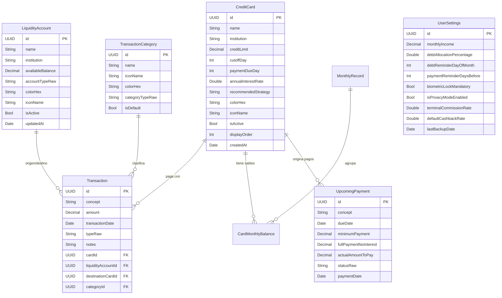
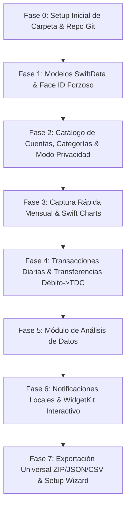

# 📱 ESPECIFICACIÓN TÉCNICA Y DE ARQUITECTURA: KASH (iOS NATIVO)

> **Versión del Documento:** 2.6.0 (Production-Ready Architecture — KASH v1.4.0 Build 6)  
> **Estado:** Implementado / Aprobado / Especificación Completa de Ingeniería  
> **Destinatario:** Ingeniero de Software iOS / Agente de IA para Desarrollo Autónomo  
> **Plataforma Objetivo:** iOS 17.0+ (iPhone / iPad) + WidgetKit  
> **Lenguaje y Frameworks:** Swift 5.10 / Swift 6 + SwiftUI + SwiftData + Swift Charts + WidgetKit (Interactive) + UserNotifications + LocalAuthentication + Apple Archive / Compression  
> **Design System:** FinTech High-Standard (Basado en `awesome-ios-design-md/finance` - Estilo Revolut / Robinhood / Wise)  
> **Skills de IA Mandatorios:** `swiftdata-pro`, `swiftui-pro`, `widgets-skill`, `app-intents-skill`, `swift-concurrency-pro`, `swift-security-skill`, `swift-testing-pro`, `swift-formatstyle-skill`

---

## 1. 🎯 VISIÓN DEL PRODUCTO Y FILOSOFÍA FINANCIERA

### 1.1 Propósito
**KASH** es una aplicación iOS nativa de grado financiero, de arquitectura **100% offline-first, segura y privada**. Sustituye y supera las hojas de cálculo tradicionales mediante una experiencia fluida, análisis predictivo de hábitos de endeudamiento, control estricto de liquidez y portabilidad absoluta.

### 1.2 ⚠️ Regla de Oro Financiera y Psicológica del Sistema
> **PRINCIPIO FUNDAMENTAL:**  
> **"El crédito disponible en una Tarjeta de Crédito NO es dinero propio."**  
> Aunque el banco otorgue una línea de crédito de $45,000, la app jamás sumará ese saldo disponible a la *Liquidez Real* ni al *Patrimonio Neto*. El disponible se presenta estrictamente como **"Capacidad de Endeudamiento / Deuda Potencial"**. La *Liquidez Real* solo se compone de dinero propio en cuentas de débito, ahorros y efectivo disponible menos la deuda total.

### 1.3 Principios No Negociables
1. **Cero Datos Hardcodeados:** La aplicación de producción **no contendrá ningún saldo, tarjeta ni monto monetario quemado en el código fuente**. Arranca limpia con un asistente de bienvenida (Onboarding) y soporte de importación inicial (CSV/JSON).
2. **Arranque Instantáneo (<100ms) y Base de Datos Encriptada:** Toda la información se almacena localmente usando `SwiftData` con protección de hardware (`FileProtectionType.completeFileProtectionUnlessOpen`), cifrada por el Secure Enclave del iPhone.
3. **Seguridad Biométrica Forzosa (`Face ID / Touch ID`):** Bloqueo mandatorio al iniciar y al volver de segundo plano, con pantalla de privacidad (*Privacy Shield Blur*) en el App Switcher de iOS.
4. **Modo Privacidad Rápido (Ocultar Saldos 👁️):** Botón flotante/header con ícono de ojo para enmascarar inmediatamente todos los montos (`$ ••••••`) al consultar la app en lugares públicos.
5. **Ubicación del Proyecto y Control de Versiones Git Obligatorio:**
   - **Ruta local del proyecto:** `C:\Users\Ulises\Downloads\utils vs code\specs\KASH`
   - **Repositorio Git Remote:** `https://github.com/BasherMX/KASH.git`
   - **Flujo de Trabajo Git:**
     - **Paso 0 (Previo a todo código):** Inicializar el repositorio Git en la carpeta de la app (`C:\Users\Ulises\Downloads\utils vs code\specs\KASH`), generar `.gitignore` (para proyectos Swift/Xcode/macOS/Windows), `README.md` inicial y realizar un **Initial Commit** con push al remoto `https://github.com/BasherMX/KASH.git`.
     - **Control Continuo:** Tras completar cada Fase del Roadmap o cualquier avance/hito relevante, realizar `git commit` con un mensaje descriptivo del cambio y ejecutar `git push origin main` (o rama correspondiente).

### 1.4 🛠️ Skills de Agente de IA Obligatorios para el Desarrollo
Todo Agente de IA que participe en el desarrollo de **KASH** debe activar y seguir rigurosamente los siguientes **Swift Agent Skills** instalados en el sistema:
- 🗄️ **`swiftdata-pro`**: Para el diseño de modelos `@Model`, relaciones, `ModelContainer` y persistencia.
- 🎨 **`swiftui-pro`**: Para la estructura de vistas reactivas SwiftUI, tokens de diseño y componentes de interfaz.
- 📱 **`widgets-skill`**: Para la construcción de la extensión de widgets `WidgetKit`.
- ⚡ **`app-intents-skill`**: Para acciones e intenciones en widgets de iOS 17+ (`QuickExpenseIntent`, `PayCardIntent`).
- 🔀 **`swift-concurrency-pro`**: Para el cumplimiento de reglas de concurrencia Swift 5.10 / Swift 6 (`@MainActor`, `Sendable`).
- 🛡️ **`swift-security-skill`**: Para la integración de `LocalAuthentication`, encriptación y protección en reposo.
- 🧪 **`swift-testing-pro`**: Para la escritura de suite de pruebas unitarias con `Swift Testing`.
- 🔢 **`swift-formatstyle-skill`**: Para el formateo estricto de montos monetarios, porcentajes y fechas.

---

## 2. 🎨 SISTEMA DE DISEÑO FINTECH (HIG + AWESOME-FINANCE-MD)

Basado en los estándares de diseño financiero (`Revolut`, `Wise`, `Robinhood`, `Stripe`):

### 2.1 Tokens de Color Adaptativos (Modo Claro / Oscuro Automático)
| Token Semántico | Modo Claro (Light) | Modo Oscuro (Dark) | Uso Principal |
| :--- | :--- | :--- | :--- |
| `backgroundPrimary` | `#F8FAFC` (Slate 50) | `#0B0E14` (Deep Canvas) | Fondo general de la app |
| `backgroundSecondary`| `#FFFFFF` (Pure White) | `#161B26` (Elevated Surface) | Tarjetas y celdas elevadas |
| `backgroundTertiary` | `#F1F5F9` (Slate 100)| `#222938` (Inset Surface) | Insets, campos de texto y chips |
| `brandPrimary` | `#2563EB` (Electric Blue) | `#3B82F6` (Neon Blue) | Botones de acción principal (CTA) |
| `scoreOptimal` | `#10B981` (Emerald) | `#059669` (Bright Emerald) | Semáforo < 30% uso |
| `scoreWarning` | `#F59E0B` (Amber) | `#D97706` (Vibrant Amber) | Semáforo 30% - 50% uso |
| `scoreCritical` | `#EF4444` (Crimson) | `#DC2626` (Intense Red) | Semáforo > 50% uso |
| `textPrimary` | `#0F172A` (Slate 900) | `#F8FAFC` (Pure White) | Títulos, importes y KPIs |
| `textSecondary` | `#64748B` (Slate 500) | `#94A3B8` (Slate 400) | Subtítulos y metadatos |
| `cardBorder` | `rgba(15, 23, 42, 0.06)` | `rgba(255, 255, 255, 0.08)`| Borde sutil de 1pt en tarjetas |

### 2.2 Tipografía y Componente de Enmascaramiento de Privacidad
- **Cifras Financieras:** San Francisco Pro Rounded `.font(.system(size: 28, weight: .bold, design: .rounded))`.
- **Formateador de Privacidad (`PrivacyAwareText`):**
  ```swift
  struct PrivacyAwareText: View {
      let amount: Decimal
      @AppStorage("isPrivacyModeEnabled") private var isPrivacyModeEnabled = false

      var body: some View {
          Text(isPrivacyModeEnabled ? "$ ••••••" : amount.formatted(.currency(code: "MXN")))
              .contentTransition(.numericText())
      }
  }
  ```

---

## 3. 💾 MODELO DE DATOS EXPANDIDO (SWIFTDATA SCHEMA)



### 3.1 Definición de Modelos en Swift (SwiftData)

```swift
import Foundation
import SwiftData

// MARK: - Tarjeta de Crédito (Pasivo Revolvente)
@Model
final class CreditCard {
    @Attribute(.unique) var id: UUID
    var name: String                       // Ej. "PLATA CARD", "HEY BANCO", "NU"
    var institution: String                // Ej. "Plata", "Banregio", "Nu"
    var creditLimit: Decimal               // Límite asignado
    var cutoffDay: Int                     // Día de corte (1-31)
    var paymentDueDay: Int                 // Día límite de pago (1-31)
    var annualInterestRate: Double         // Tasa de interés anual (ej. 0.5900 = 59.0%)
    var recommendedStrategy: String        // Ej. "Categorías 5% Cashback"
    var colorHex: String                   // Color personalizado
    var iconName: String                   // SF Symbol
    var isActive: Bool                     // Activa o Archivada
    var displayOrder: Int
    var createdAt: Date

    @Relationship(deleteRule: .cascade, inverse: \CardMonthlyBalance.card)
    var balances: [CardMonthlyBalance]? = []

    @Relationship(deleteRule: .cascade, inverse: \UpcomingPayment.card)
    var upcomingPayments: [UpcomingPayment]? = []

    @Relationship(deleteRule: .nullify, inverse: \Transaction.creditCard)
    var transactions: [Transaction]? = []

    init(
        name: String,
        institution: String,
        creditLimit: Decimal,
        cutoffDay: Int,
        paymentDueDay: Int,
        annualInterestRate: Double = 0.0,
        recommendedStrategy: String = "",
        colorHex: String = "#1E293B",
        iconName: String = "creditcard.fill",
        isActive: Bool = true,
        displayOrder: Int = 0
    ) {
        self.id = UUID()
        self.name = name
        self.institution = institution
        self.creditLimit = creditLimit
        self.cutoffDay = cutoffDay
        self.paymentDueDay = paymentDueDay
        self.annualInterestRate = annualInterestRate
        self.recommendedStrategy = recommendedStrategy
        self.colorHex = colorHex
        self.iconName = iconName
        self.isActive = isActive
        self.displayOrder = displayOrder
        self.createdAt = Date()
    }
    
    var currentBalance: Decimal {
        guard let balances = balances, !balances.isEmpty else { return 0 }
        let sorted = balances.sorted { $0.recordedAt > $1.recordedAt }
        return sorted.first?.balanceUsed ?? 0
    }
    
    var availableCredit: Decimal {
        max(0, creditLimit - currentBalance)
    }
    
    var utilizationPercentage: Double {
        guard creditLimit > 0 else { return 0 }
        return NSDecimalNumber(decimal: currentBalance / creditLimit).doubleValue
    }
}

// MARK: - Cuenta de Liquidez / Activo (Débito, Efectivo, Préstamo Pasivo)
@Model
final class LiquidityAccount {
    @Attribute(.unique) var id: UUID
    var name: String                       // Ej. "BBVA Nómina", "Efectivo", "Préstamo Stori"
    var institution: String                // Ej. "BBVA", "Efectivo", "Stori"
    var availableBalance: Decimal          // Saldo líquido positivo o saldo deudor si es préstamo
    var accountTypeRaw: String             // "debit", "cash", "savings", "loan"
    var colorHex: String
    var iconName: String
    var isActive: Bool
    var updatedAt: Date

    @Relationship(deleteRule: .nullify, inverse: \Transaction.liquidityAccount)
    var transactions: [Transaction]? = []

    var accountType: AccountType {
        get { AccountType(rawValue: accountTypeRaw) ?? .debit }
        set { accountTypeRaw = newValue.rawValue }
    }

    init(
        name: String,
        institution: String,
        availableBalance: Decimal,
        accountType: AccountType = .debit,
        colorHex: String = "#2563EB",
        iconName: String = "banknote.fill",
        isActive: Bool = true
    ) {
        self.id = UUID()
        self.name = name
        self.institution = institution
        self.availableBalance = availableBalance
        self.accountTypeRaw = accountType.rawValue
        self.colorHex = colorHex
        self.iconName = iconName
        self.isActive = isActive
        self.updatedAt = Date()
    }
}

enum AccountType: String, CaseIterable, Codable {
    case debit = "debit"                   // Cuenta de débito
    case cash = "cash"                     // Efectivo
    case savings = "savings"               // Cuenta de rendimiento / cajita
    case loan = "loan"                     // Préstamo personal / crédito no revolvente

    var title: String {
        switch self {
        case .debit: return "Tarjeta de Débito"
        case .cash: return "Efectivo"
        case .savings: return "Ahorro / Rendimiento"
        case .loan: return "Préstamo / Crédito Personal"
        }
    }
}

// MARK: - Categorías de Transacción
@Model
final class TransactionCategory {
    @Attribute(.unique) var id: UUID
    var name: String                       // Ej. "Supermercado", "Servicios", "Nómina"
    var iconName: String                   // SF Symbol
    var colorHex: String
    var categoryTypeRaw: String            // "expense", "income"
    var isDefault: Bool

    @Relationship(deleteRule: .nullify, inverse: \Transaction.category)
    var transactions: [Transaction]? = []

    var categoryType: TransactionType {
        get { TransactionType(rawValue: categoryTypeRaw) ?? .expense }
        set { categoryTypeRaw = newValue.rawValue }
    }

    init(name: String, iconName: String, colorHex: String, categoryType: TransactionType = .expense, isDefault: Bool = false) {
        self.id = UUID()
        self.name = name
        self.iconName = iconName
        self.colorHex = colorHex
        self.categoryTypeRaw = categoryType.rawValue
        self.isDefault = isDefault
    }
}

// MARK: - Transacciones Diarias & Transferencias / Pagos
@Model
final class Transaction {
    @Attribute(.unique) var id: UUID
    var concept: String                    // Ej. "Pago Supermercado", "Abono a Plata Card"
    var amount: Decimal                    // Monto
    var transactionDate: Date              // Fecha y hora
    var typeRaw: String                    // "expense", "income", "cardPayment", "transfer"
    var notes: String?
    var createdAt: Date

    @Relationship var creditCard: CreditCard?
    @Relationship var liquidityAccount: LiquidityAccount?
    @Relationship var destinationCard: CreditCard?     // Para pagos a TDC desde cuenta de débito
    @Relationship var category: TransactionCategory?

    var type: TransactionType {
        get { TransactionType(rawValue: typeRaw) ?? .expense }
        set { typeRaw = newValue.rawValue }
    }

    init(
        concept: String,
        amount: Decimal,
        transactionDate: Date = Date(),
        type: TransactionType = .expense,
        notes: String? = nil,
        creditCard: CreditCard? = nil,
        liquidityAccount: LiquidityAccount? = nil,
        destinationCard: CreditCard? = nil,
        category: TransactionCategory? = nil
    ) {
        self.id = UUID()
        self.concept = concept
        self.amount = amount
        self.transactionDate = transactionDate
        self.typeRaw = type.rawValue
        self.notes = notes
        self.creditCard = creditCard
        self.liquidityAccount = liquidityAccount
        self.destinationCard = destinationCard
        self.category = category
        self.createdAt = Date()
    }
}

enum TransactionType: String, CaseIterable, Codable {
    case expense = "expense"               // Gasto/Compra diaria
    case income = "income"                 // Ingreso a cuenta de débito/efectivo
    case cardPayment = "cardPayment"       // Pago/Transferencia a Tarjeta de Crédito
    case transfer = "transfer"             // Traspaso entre cuentas de liquidez

    var title: String {
        switch self {
        case .expense: return "Gasto / Compra"
        case .income: return "Ingreso"
        case .cardPayment: return "Pago a Tarjeta"
        case .transfer: return "Transferencia"
        }
    }
}

// MARK: - Registro Mensual Consolidado
@Model
final class MonthlyRecord {
    @Attribute(.unique) var id: UUID
    var periodDate: Date                   // Primer día del mes (ej. 2026-10-01)
    var notes: String?
    var createdAt: Date

    @Relationship(deleteRule: .cascade, inverse: \CardMonthlyBalance.monthlyRecord)
    var balances: [CardMonthlyBalance]? = []

    init(periodDate: Date, notes: String? = nil) {
        self.id = UUID()
        self.periodDate = periodDate
        self.notes = notes
        self.createdAt = Date()
    }

    var totalDebt: Decimal {
        guard let balances = balances else { return 0 }
        return balances.reduce(0) { $0 + $1.balanceUsed }
    }
}

// MARK: - Saldo por Tarjeta en Corte Mensual
@Model
final class CardMonthlyBalance {
    @Attribute(.unique) var id: UUID
    var balanceUsed: Decimal
    var recordedAt: Date
    var card: CreditCard?
    var monthlyRecord: MonthlyRecord?

    init(balanceUsed: Decimal, recordedAt: Date = Date(), card: CreditCard? = nil, monthlyRecord: MonthlyRecord? = nil) {
        self.id = UUID()
        self.balanceUsed = balanceUsed
        self.recordedAt = recordedAt
        self.card = card
        self.monthlyRecord = monthlyRecord
    }
}

// MARK: - Próximo Pago del Mes
@Model
final class UpcomingPayment {
    @Attribute(.unique) var id: UUID
    var concept: String
    var dueDate: Date
    var minimumPayment: Decimal
    var fullPaymentNoInterest: Decimal
    var actualAmountToPay: Decimal
    var statusRaw: String                  // "pending", "paid", "partial"
    var paymentDate: Date?
    var card: CreditCard?

    var status: PaymentStatus {
        get { PaymentStatus(rawValue: statusRaw) ?? .pending }
        set { statusRaw = newValue.rawValue }
    }

    init(
        concept: String,
        dueDate: Date,
        minimumPayment: Decimal = 0,
        fullPaymentNoInterest: Decimal = 0,
        actualAmountToPay: Decimal = 0,
        status: PaymentStatus = .pending,
        card: CreditCard? = nil
    ) {
        self.id = UUID()
        self.concept = concept
        self.dueDate = dueDate
        self.minimumPayment = minimumPayment
        self.fullPaymentNoInterest = fullPaymentNoInterest
        self.actualAmountToPay = actualAmountToPay
        self.statusRaw = status.rawValue
        self.card = card
    }
}

enum PaymentStatus: String, CaseIterable, Codable {
    case pending = "pending"
    case paid = "paid"
    case partial = "partial"

    var title: String {
        switch self {
        case .pending: return "Pendiente"
        case .paid: return "Pagado"
        case .partial: return "Parcial"
        }
    }
}

// MARK: - Configuración de Usuario y Sistema
@Model
final class UserSettings {
    @Attribute(.unique) var id: UUID
    var monthlyIncome: Decimal             // Sueldo mensual neto
    var debtAllocationPercentage: Double   // % de sueldo para abono de deuda
    var debtReminderDayOfMonth: Int        // Día del mes para corte
    var paymentReminderDaysBefore: Int     // Días de anticipación para avisar pagos
    var biometricLockMandatory: Bool       // Face ID / Touch ID Obligatorio
    var isPrivacyModeEnabled: Bool         // Ocultar saldos por defecto
    var terminalCommissionRate: Double     // Tasa terminal (ej. 0.0406 = 4.06%)
    var defaultCashbackRate: Double        // Cashback (ej. 0.10 = 10%)
    var lastBackupDate: Date?

    init(
        monthlyIncome: Decimal = 0,
        debtAllocationPercentage: Double = 0.60,
        debtReminderDayOfMonth: Int = 5,
        paymentReminderDaysBefore: Int = 3,
        biometricLockMandatory: Bool = true,
        isPrivacyModeEnabled: Bool = false,
        terminalCommissionRate: Double = 0.0406,
        defaultCashbackRate: Double = 0.10
    ) {
        self.id = UUID()
        self.monthlyIncome = monthlyIncome
        self.debtAllocationPercentage = debtAllocationPercentage
        self.debtReminderDayOfMonth = debtReminderDayOfMonth
        self.paymentReminderDaysBefore = paymentReminderDaysBefore
        self.biometricLockMandatory = biometricLockMandatory
        self.isPrivacyModeEnabled = isPrivacyModeEnabled
        self.terminalCommissionRate = terminalCommissionRate
        self.defaultCashbackRate = defaultCashbackRate
        self.lastBackupDate = nil
    }
}
```

---

## 4. 💳 GESTIÓN DE PAGOS Y TRANSFERENCIAS (DÉBITO ➡️ TDC)

La app cuenta con un flujo directo de **Pago de Tarjeta / Transferencia**:

```
┌─────────────────────────────────────────────────────────┐
│              REALIZAR PAGO A TARJETA DE CRÉDITO         │
├─────────────────────────────────────────────────────────┤
│ ORIGEN (Cuenta de Liquidez):                            │
│ [ 🏦 BBVA Nómina  •  Disponible: $ 4,735.73 ]          │
├─────────────────────────────────────────────────────────┤
│ DESTINO (Tarjeta a Pagar):                              │
│ [ 💳 PLATA CARD   •  Saldo Deudor: $ 17,144.50 ]        │
├─────────────────────────────────────────────────────────┤
│ MONTO A PAGAR:                                          │
│ [ $ 4,000.00 ]   [ Botón: Pagar Todo el Mes ]           │
├─────────────────────────────────────────────────────────┤
│ [ CONFIRMAR PAGO Háptico ]                              │
└─────────────────────────────────────────────────────────┘
```

### 4.1 Lógica de Ejecución Atómica en SwiftData
Al confirmar el pago:
1. `LiquidityAccount.availableBalance -= 4000.00`
2. Si la tarjeta tiene `CardMonthlyBalance`, se descuenta el saldo deudor: `CardMonthlyBalance.balanceUsed -= 4000.00`.
3. Si existe un `UpcomingPayment` pendiente para esa tarjeta en el mes, su `status` cambia automáticamente a `.paid` (o `.partial`).
4. Se registra un `Transaction` tipo `.cardPayment` para auditoría y trazabilidad histórica.

---

## 5. 🧠 MÓDULO DE ANÁLISIS DE DATOS E INTELIGENCIA FINANCIERA

Se ubica como una pestaña principal en el menú: **`Análisis` (`AnalyticsView`)**.

### 5.1 Capacidades Analíticas Detalladas
1. **Desglose de Gastos por Categoría (`SectorMark` / Donut Chart):**
   - Agrupación por categoría (Supermercado, Servicios, Restaurantes, Compras, etc.).
   - Ranking de las 5 categorías donde más se gasta dinero.
2. **Velocidad de Endeudamiento (*Burn Rate vs. Payoff Rate*):**
   - Compara gastos acumulados del mes vs. abonos realizados a deudas.
   - Indicador dinámico: 🟢 *Amortizando Deuda Neta* vs. 🔴 *Quemando Capital (Sobreendeudándose)*.
3. **Detector de Concentración de Deuda:**
   - Muestra qué porcentaje de la deuda total está en tarjetas con tasa de interés abusiva (>80% anual).
   - Genera recomendaciones automáticas bajo el **Método Avalancha** (liquidar primero las tarjetas más costosas).
4. **Proyección y Estimación de Deuda Cero:**
   - Modelo predictivo de amortización que estima la fecha exacta en la que tu deuda llegará a $0.00 según tu capacidad de abono.

---

## 6. 📲 WIDGETS NATIVOS INTERACTIVOS (`WidgetKit`)

Un target dedicado de extensión de widgets (`ControlTDCWidgets`) con soporte interactivo de iOS 17+:

```
┌────────────────────────┐  ┌─────────────────────────────────────────────────────────┐
│ WIDGET SMALL (2x2)     │  │ WIDGET MEDIUM INTERACTIVO (4x2)                         │
│                        │  │                                                         │
│ 💳 DEUDA TOTAL         │  │ 💳 DEUDA TOTAL           % UTILIZACIÓN      SALUD BURÓ  │
│ $ 39,375.71            │  │ $ 39,375.71              27.4%              🟢 ÓPTIMO   │
│                        │  │ ─────────────────────────────────────────────────────── │
│ 🟢 Óptimo (27.4% uso)  │  │ ⚡ ACCIONES RÁPIDAS:                                    │
│ Próx: HEY BANCO (3d)   │  │ [ + Gasto ]      [ + Ingreso ]      [ Pagar TDC ]       │
└────────────────────────┘  └─────────────────────────────────────────────────────────┘
```

### 6.1 Familias de Widgets Soportadas
1. **`systemSmall`:** Resumen rápido de Deuda Total + Badge de Semáforo de salud.
2. **`systemMedium` (Interactivo):** Desglose rápido de deuda, porcentaje de utilización y **botones de acción rápida interactivos** con `AppIntents` (`QuickExpenseIntent`, `QuickIncomeIntent`, `PayCardIntent`) que abren la app directamente en el modal de captura.
3. **`systemLarge`:** Desglose gráfico de gastos de la semana + lista de próximas 3 tarjetas por vencer.
4. **`accessoryRectangular` y `accessoryCircular`:** Indicadores directos en la Pantalla de Bloqueo (Lock Screen).

---

## 7. ⚙️ MÓDULO DE CONFIGURACIÓN Y ADMINISTRACIÓN DE CATÁLOGOS

La pestaña **`Configuración` (`SettingsView`)** centraliza la administración total de la app:

### 7.1 Secciones de la Pantalla de Configuración
1. **🛡️ Seguridad & Privacidad:**
   - Toggle: *Face ID / Touch ID Obligatorio al Abrir*.
   - Toggle: *Ocultar Saldos por Defecto (Modo Privacidad 👁️)*.
2. **💳 Catálogos de Cuentas y Pasivos (Altas / Bajas / Cambios):**
   - **Tarjetas de Crédito:** Añadir, editar límites, fechas de corte/pago, color, archivar o eliminar.
   - **Cuentas de Débito y Efectivo:** Añadir cuentas de nómina, cajitas de ahorro o billeteras de efectivo.
   - **Préstamos y Financiamientos:** Añadir préstamos fijos (Stori, Mercado Pago, etc.).
3. **🏷️ Categorías de Gastos e Ingresos:**
   - Crear y editar categorías personalizadas: Nombre, Tipo (Gasto/Ingreso), Ícono SF Symbol y Color.
4. **🔔 Notificaciones y Recordatorios:**
   - Día del mes para recordatorio de registro de cortes (ej. Día 5).
   - Días de anticipación para alerta de vencimiento de tarjetas (ej. 3 días antes).
5. **🧮 Parámetros de Simuladores:**
   - Sueldo Mensual del usuario.
   - % de ahorro/abono destinado a deuda.
   - Tasa de comisión de terminal y cashback por defecto.
6. **📦 Copias de Seguridad, Exportación e Importación:**
   - *Exportar Respaldo Universal Completo (Paquete ZIP sin pérdida).*
   - *Exportar Reporte CSV.*
   - *Importar Respaldo (ZIP / JSON / CSV).*
7. **ℹ️ Pie de Página del Sistema (Footer):**
   - Versión de la Aplicación: `Control TDC v1.0.0 (Build 1)`.
   - Estado de la Base de Datos: `Almacenamiento Local SwiftData Encriptado (0 KB en nube)`.

---

## 8. 📦 ESTRATEGIA DE EXPORTACIÓN UNIVERSAL MODULAR (ZIP MULTI-FILE)

### 8.1 Problema del JSON Único Gigante y Solución
> **Problema:** Al pasar los meses y registrar miles de transacciones y cortes históricos, generar un único archivo `.json` de 50 MB provoca bloqueos de memoria en el dispositivo y es ineficiente para migrar a bases de datos en la nube.  
> **Solución de Ingeniería:** **Exportación en Paquete ZIP Modular Normalizado** (`ControlTDC_Backup_YYYYMMDD.zip`) mediante `Apple Archive` o compresión `zlib`.

```
📦 ControlTDC_Backup_20261009_193000.zip
├── 📄 manifest.json                  (Metadatos, versión del schema, checksum SHA-256)
├── 📄 user_settings.json             (Configuración, sueldo, recordatorios)
├── 📄 credit_cards.json              (Catálogo de tarjetas de crédito)
├── 📄 liquidity_accounts.json         (Cuentas de débito, efectivo y préstamos)
├── 📄 categories.json                (Categorías de gastos e ingresos)
├── 📄 monthly_records.json           (Historial de cortes mensuales y saldos)
├── 📄 upcoming_payments.json         (Compromisos y pagos del mes)
├── 📁 transactions/                  (Transacciones particionadas por año)
│   ├── 📄 transactions_2024.json
│   ├── 📄 transactions_2025.json
│   └── 📄 transactions_2026.json
└── 📁 csv_reports/                   (Archivos CSV para abrir directo en Excel)
    ├── 📄 tarjetas.csv
    ├── 📄 historial_mensual.csv
    └── 📄 transacciones.csv
```

### 8.2 Manifiesto Canónico (`manifest.json`)
```json
{
  "schemaVersion": "2.1.0",
  "appVersion": "1.0.0",
  "buildNumber": 1,
  "exportedAt": "2026-10-09T19:30:00Z",
  "deviceModel": "iPhone 16 Pro",
  "entityCounts": {
    "creditCards": 7,
    "liquidityAccounts": 4,
    "categories": 12,
    "monthlyRecords": 22,
    "transactions": 450,
    "upcomingPayments": 8
  },
  "checksumSHA256": "8f4e2c1a..."
}
```

---

## 9. ⚡ REQUISITOS NO FUNCIONALES (VELOCIDAD, SEGURIDAD Y RENDIMIENTO)

1. **Tiempo de Arranque (Time to Interactive):** Sub-100 milisegundos. Todas las vistas principales utilizan consultas locales optimizadas `@Query` con índices en memoria.
2. **Encriptación en Reposo:**
   - La base de datos local SQLite administrada por `SwiftData` se crea bajo la carpeta de la app con el atributo `.completeFileProtectionUnlessOpen`.
   - Si el iPhone está bloqueado con pantalla apagada, las claves criptográficas se descargan de la RAM, impidiendo el acceso a los datos incluso mediante volcados forenses.
3. **Consumo de Memoria:** < 45 MB de RAM en ejecución normal.
4. **Cero Conexión a Internet:** No se realizan peticiones HTTP de ningún tipo; la app funciona al 100% en modo avión.

---

## 10. 🗺️ ROADMAP DE IMPLEMENTACIÓN METÓDICA (PARA LA IA)



> **⚠️ Regla de Control de Versiones:** Tras finalizar los entregables de cada Fase (o sub-hito relevante), se DEBE realizar `git commit` y `git push origin main` al repositorio `https://github.com/BasherMX/KASH.git`.

### 🔹 Fase 0: Inicialización del Repositorio Git y Estructura Base
- Crear carpeta del proyecto en `C:\Users\Ulises\Downloads\utils vs code\specs\KASH`.
- Inicializar `git init`.
- Crear `.gitignore` optimizado para Swift/Xcode/macOS.
- Crear `README.md` descriptivo con la visión de **KASH**.
- Conectar remote `https://github.com/BasherMX/KASH.git`.
- Realizar **Initial Commit** y `git push -u origin main` previo a escribir código.

### 🔹 Fase 1: Arquitectura Base, SwiftData y Face ID
- Configurar proyecto Xcode iOS 17+.
- Implementar los modelos `@Model`: `CreditCard`, `LiquidityAccount`, `TransactionCategory`, `Transaction`, `MonthlyRecord`, `CardMonthlyBalance`, `UpcomingPayment`, `UserSettings`.
- Implementar `PrivacyShieldView` y `BiometricAuthManager` en el ciclo `ScenePhase`.
- Implementar componente `PrivacyAwareText` con botón toggle de Ojo 👁️.
- *Commit & Push al remoto.*

### 🔹 Fase 2: Catálogo de Cuentas, Categorías y Configuración
- Vistas de gestión para agregar/editar/eliminar Tarjetas de Crédito, Débito, Préstamos y Efectivo.
- Vista de gestión de Categorías con selector de íconos y colores.
- Pantalla de Configuración con Footer de versión del sistema.
- *Commit & Push al remoto.*

### 🔹 Fase 3: Captura Rápida Mensual y Swift Charts
- Construir formulario vertical `BatchLogSheet` para registrar cortes en 15 segundos.
- Historial cronológico con deltas ($ y %).
- Gráficos en Swift Charts: Curva de deuda histórica y barras de límite vs saldo.
- *Commit & Push al remoto.*

### 🔹 Fase 4: Transacciones y Pagos Débito ➡️ TDC
- Construir `QuickTransactionSheet` (compras e ingresos).
- Construir `CardPaymentSheet` (transferencias directas de débito/efectivo a TDC con descuento atómico de deuda).
- Control de liquidez y balance neto (Superávit / Déficit).
- *Commit & Push al remoto.*

### 🔹 Fase 5: Módulo de Análisis de Datos
- Construir la pestaña `AnalyticsView` con Donut Chart de categorías, velocidad de endeudamiento, índice de concentración de deuda y estimación de Deuda Cero.
- *Commit & Push al remoto.*

### 🔹 Fase 6: Notificaciones Locales y Widgets Interactivos
- Configurar `NotificationManager` (recordatorio de cortes y vencimientos).
- Crear target `KASHWidgets` con widget interactivo `systemMedium` con botones de acción rápida.
- *Commit & Push al remoto.*

### 🔹 Fase 8: Actualización Mayor v1.1.0 (Build 2) — Correcciones Críticas de UI, Historial Individual por Tarjeta y Portabilidad Universal
- **Corrección de Pantalla 100% y Letterbox:** Diagnóstico y solución definitiva de la falta de ocupación completa de la pantalla en dispositivos físicos iOS. Se integró `UILaunchScreen` en `project.yml`, `Info.plist` y scripts de empaquetado `build.yml`, evitando la degradación al modo legacy letterbox de iOS.
- **Autenticación Biométrica Desactivada por Defecto:** Se modificó la política de inicialización (`UserSettings.biometricLockMandatory = false`) para que el usuario elija activarla voluntariamente desde Ajustes, eliminando bloqueos obligatorios inesperados en el primer inicio.
- **Gestión Avanzada de Cortes Mensuales:**
  - Edición y eliminación directa de registros mensuales con confirmación de seguridad.
  - Regla estricta de corte único por mes: si se intenta registrar el mismo periodo, el sistema actualiza el registro existente en vez de duplicar.
  - Orden cronológico riguroso: las tarjetas siempre toman como saldo actual el corte más reciente según el calendario (`periodDate`), eliminando el bug por orden de inserción `recordedAt`.
  - Tarjetas colapsadas por defecto con revelación animada de desglose al pulsar.
- **Edición Completa de Movimientos:** Tocar cualquier transacción en `TransactionsListView` o deslizar lateralmente abre `QuickTransactionSheet` en modo edición para corregir montos, conceptos, cuentas o categorías con impacto atómico sincronizado en balances de liquidez.
- **Historial Individual por Tarjeta de Crédito:**
  - Nueva pantalla de detalle `CreditCardDetailView` accesible directamente al tocar cualquier tarjeta en el Dashboard ("Tus Tarjetas de Crédito") o en el catálogo de Ajustes.
  - Gráfica interactiva de evolución de deuda individual con `Swift Charts` (curva de amortización mes a mes).
  - Desglose cronológico de cortes históricos específicos de la tarjeta con deltas ($ y %) y lista de movimientos recientes.
- **Nuevo App Icon Corporativo "K":**
  - Generación e integración del icono oficial de KASH con la letra "K" geométrica facetada estilo origami 3D sobre fondo grafito mate oscuro.
  - Configuración completa en Asset Catalog `KASH/Assets.xcassets/AppIcon.appiconset` y `project.yml` (`ASSETCATALOG_COMPILER_APPICON_NAME: AppIcon`).
- **Descarte de Teclado Global:** Inclusión de `.scrollDismissesKeyboard(.interactively)`, dismiss en fondos y barra de herramientas con botón "Listo" en todos los formularios y sheets para cierre garantizado del teclado numérico/decimal.
- **Ocultamiento Contextual del Modo Privacidad (Ojo 👁️):** Se retiró el toggle de privacidad de las pantallas donde no existen montos (Ajustes), manteniéndolo activo únicamente en vistas con cifras financieras sensibles (Dashboard, Movimientos, Cortes, Análisis y Detalle de Tarjeta).
- **Fechas de Corte Específicas por Tarjeta:** Eliminado el picker global de día de corte de Ajustes; cada tarjeta maneja su propio día de corte (`cutoffDay`) y fecha límite de pago (`paymentDueDay`).
- **Eliminación Total de Estrategia Cashback:** Depuración completa de los campos, DTOs y textos relacionados con tasas de cashback promedio y sugerencias en tarjetas y configuración.
- **Copias de Seguridad y Portabilidad 100% Funcionales:**
  - Implementación de exportación a archivo único JSON modular consolidado (`KASH_Respaldo_*.json`) mediante `UIActivityViewController` (ShareSheet nativo de iOS) para guardar en Archivos, iCloud o AirDrop.
  - Implementación de importación integral con selector de documentos (`.fileImporter`) que restaura tarjetas, cuentas, categorías, cortes, saldos y movimientos directamente en SwiftData.
  - Creación de archivos semilla `sample_kash_data.json` y `sample_kash_data.csv` en la raíz de especificaciones para pruebas inmediatas de carga.
- **Ampliación de Paleta de Colores:** 24 colores curados de alta fidelidad FinTech más selector `ColorPicker` para personalización libre de tarjetas.
- **Diagnóstico de Widgets en Sideloading:** Identificación de limitaciones de cuentas gratuitas de Apple en Sideloadly (remoción automática de app extensions por límite de App IDs, necesidad de Developer Mode y reinicio de SpringBoard para indexar extensiones en la galería).

### 🔹 Fase 9: Actualización v1.2.0 (Build 3) — App Icon Full-Bleed HIG, Cierre Táctil de Teclado Invisible y Upsert Idempotente de Respaldos
- **App Icon Full-Bleed Nativo (Apple HIG):** Se regeneró e integró el icono oficial a 1024x1024 px eliminando cualquier card interno o squircle falso con bordes oscuros. El fondo grafito carbón mate se extiende al 100% hasta los bordes del lienzo, permitiendo que el radio de curvatura y sombreado sean administrados exclusivamente por el sistema operativo iOS.
- **Cierre Táctil Universal de Teclado (`dismissKeyboardOnTap`):** Se implementó un `KeyboardDismissOverlay` invisible con `UITapGestureRecognizer` (`cancelsTouchesInView = false`) que intercepta toques en cualquier espacio en blanco o contenedor de la aplicación y descarta el teclado inmediatamente, respetando toques nativos dentro de campos de texto interactivos (`UITextField`, `UITextView`). Se incorporó tanto en la vista raíz `RootView` como en todos los formularios y sheets modales.
- **Importación Idempotente y Desduplicación en `BackupManager`:** Se refinó la importación de respaldos JSON (`importBackup`) para verificar entidades preexistentes antes de insertar. Las tarjetas, cuentas de liquidez, categorías y cortes mensuales con el mismo periodo se actualizan (upsert) en lugar de crear registros duplicados, asegurando la regla estricta de un solo corte por mes.
- **Exportación con Presentación Nativa de ShareSheet:** En `SettingsView`, se optimizó la invocación de `UIActivityViewController` para presentarse directamente desde el `UIViewController` activo con soporte para popovers en iPad, resolviendo inconsistencias al compartir en la app Archivos o AirDrop.
- **Suite de Pruebas Ampliada:** Se agregaron pruebas de decodificación y estructura JSON para el paquete universal de respaldo en `KASHFinancialTests`.
- **Incremento de Versión:** Actualizado a `1.2.0` (Build `3`) en `project.yml`, `Info.plist`, `KASHWidgets/Info.plist` y el pipeline de compilación CI/CD de GitHub Actions.

### 🔹 Fase 10: Actualización v1.2.1 (Build 4) — Borrado Total de Datos con Doble Confirmación Criptográfica y Restablecimiento de Fábrica
- **Botón Destructivo "Borrar todos los datos":** Ubicado al final de la pantalla de Ajustes (`SettingsView`) dentro de una sección dedicada de peligro en tipografía roja (`.foregroundStyle(Color.red)`), advirtiendo que los datos no se podrán recuperar.
- **Doble Confirmación de Seguridad:**
  1. **Primera Confirmación (Modal Alert):** Advertencia destructiva explícita: *"⚠️ ¿Eliminar todos los datos de KASH? Esta acción es irreversible. Se eliminarán permanentemente todas tus tarjetas, cuentas, movimientos, cortes históricos y configuraciones. No se podrán recuperar."* con opciones de Cancelar y Continuar.
  2. **Segunda Confirmación (Biometría / Código de Dispositivo):** Integración con `LocalAuthentication` mediante `LAContext().evaluatePolicy(.deviceOwnerAuthentication, localizedReason: "Ingresa el código de tu iPhone o Face ID para autorizar el borrado total de KASH")`, admitiendo Face ID, Touch ID o código numérico del iPhone.
- **Lógica Integral de Borrado (`DataResetManager`):**
  - Eliminación atómica de todas las instancias de `Transaction`, `CreditCard`, `LiquidityAccount`, `MonthlyRecord`, `CardMonthlyBalance` y `UpcomingPayment`.
  - Reinstalación de las 9 categorías estándar y reinicio de `UserSettings` a valores iniciales por defecto.
  - Reseteo de la bandera de bienvenida (`hasCompletedOnboarding`) en `UserDefaults` para relanzar el onboarding si se desea.
  - Limpieza de la instantánea de widgets compartidos (`KASHSharedStore.saveSnapshot(.sample)`) y recarga inmediata de líneas de tiempo con `WidgetCenter.shared.reloadAllTimelines()`.
  - Transición fluida al tab de Resumen (`.dashboard`) con presentación del flujo de Onboarding y respuesta háptica de advertencia.
- **Incremento de Versión y Empaquetado:** Actualizado a `1.2.1 (Build 4)` en `project.yml`, `Info.plist`, `KASHWidgets/Info.plist`, `SettingsView.swift`, `BackupManager.swift` y el flujo de CI/CD en `.github/workflows/build.yml`.
- **Pruebas Unitarias:** Implementación de prueba automatizada `testDataResetManagerWipeAllData` con Swift Testing en `KASHFinancialTests`.

### 🔹 Fase 11: Actualización v1.3.0 (Build 5) — Corrección Integral de Widgets, Selector Superior de Mes/Histórico, Agrupación Anual Colapsable y Tarjetas Físicas con Chip EMV
- **Reparación y Expansión de Widgets (`KASHWidgets` + `AppIntents` Compartidos + Entitlements):**
  - Se activó `APPLICATION_EXTENSION_API_ONLY: YES` (`MH_APP_EXTENSION_SAFE`) y `SKIP_INSTALL: YES` en `KASHWidgets`, integrando `Assets.xcassets` (`AppIcon`), `LD_RUNPATH_SEARCH_PATHS` y homologando `CFBundleDisplayName = KASH` para indexación inmediata en la galería de widgets de iOS.
  - Se añadieron los archivos de entitlements `KASH/KASH.entitlements` y `KASHWidgets/KASHWidgets.entitlements` (`com.apple.security.application-groups` = `group.com.kash.app`), configurando `CODE_SIGN_ENTITLEMENTS` en `project.yml` y firmando con `--entitlements` en `.github/workflows/build.yml`.
  - Se implementó resolución dinámica de App Groups en `KASHSharedStore` (inspeccionando `embedded.mobileprovision`, el `bundleIdentifier` en tiempo de ejecución para soportar sufijos de equipo de Sideloadly/AltStore y `group.com.kash.app`) con persistencia dual en archivo compartido (`kash_widget_snapshot.json`) dentro del contenedor del grupo y `UserDefaults`.
  - Se implementó `KASHWidgetSyncService.sync(modelContext:)` invocado tras cada mutación financiera (alta/edición/eliminación de gastos, ingresos, pagos de tarjeta, cortes mensuales, tarjetas, cuentas, importación de respaldos y restablecimiento de fábrica) y `KASHShortcutsProvider` (`AppShortcutsProvider`) para exponer acciones en Spotlight/Atajos.
  - Se amplió `KASHWidgetsBundle` a 3 widgets independientes en la galería: **KASH Deuda y Liquidez** (`.systemSmall`, `.systemMedium`, `.systemLarge`), **KASH Próximos Pagos** (`.systemSmall`, `.systemMedium`) y **KASH Pantalla de Bloqueo** (`.accessoryRectangular`, `.accessoryCircular`, `.accessoryInline`), además de diagnóstico de `PlugIns/KASHWidgets.appex` en `Ajustes`.
- **Selector Superior de Periodo (Mes Actual por Defecto / Cambiar de Mes / Ver Histórico):**
  - Implementación del componente `PeriodFilterHeaderView` ubicado en la parte superior de las pestañas **Movimientos** (`TransactionsListView`), **Cortes** (`BatchesHistoryView`) y **Análisis** (`AnalyticsView`).
  - Por defecto filtra y presenta los datos del **Mes Actual**, permitiendo cambiar rápidamente de mes (`<`, `>`, menú de mes/año) o alternar al modo **Histórico Completo**.
- **Agrupación por Año y Colapsado (Año Actual Descolapsado por Defecto):**
  - En **Historial de Cortes** (`BatchesHistoryView`), **Movimientos en modo Histórico** (`TransactionsListView`), **Detalle de Tarjeta > Cortes** (`CardHistoricalCutsSection`) y **Detalle de Tarjeta > Movimientos** (`CardRecentTransactionsSection`), los registros se agrupan cronológicamente por año con cabeceras colapsables interactivas, manteniendo el **año actual descolapsado por defecto** y los años anteriores colapsados. En `BatchesHistoryView`, la sección de historial agrupado por año permanece siempre accesible debajo del corte del mes seleccionado.
- **Diseño Realista de Tarjeta de Crédito Física en Resumen ("Tus Tarjetas de Crédito"):**
  - Rediseño de `CreditCardMiniCard` en `DashboardView` (`238x150`) y `CardVisualHero` en `CreditCardDetailView` (`.aspectRatio(1.586, contentMode: .fit)`) con proporción estándar ISO/IEC 7810 ID-1 (`1.586:1`), chip metálico EMV (`EMVCardChipView`) con líneas de contacto, ícono Contactless NFC (`wave.3.right`), numeración en relieve (`••••`), barra de progreso de utilización integrada, textura geométrica con borde especular y emblema de red de pagos.
- **Depuración y Autoguardado Garantizado en Ajustes (`SettingsView` + `UserSettings` + `CurrencyInputParser`):**
  - Eliminada la opción de `"Comisión Terminal (%)"` de la interfaz de Ajustes.
  - Implementado `CurrencyInputParser.parseDecimal(_:)` con soporte completo para coma decimal (`"25000,50"`), separadores de miles (`"25,000.50"`, `"25.000,50"`) y símbolos monetarios en todos los formularios de la app.
  - Consolidación singleton determinista `UserSettings.shared(in:)` y `UserSettings.updateMonthlyIncome(_:in:)` que elimina filas duplicadas de `UserSettings` en SwiftData y respalda el ingreso mensual neto en `UserDefaults`, con autoguardado inmediato al perder el foco (`@FocusState` + `.onChange(of: isMonthlyIncomeFocused)`), al editar (`.onChange(of: monthlyIncomeString)`), al enviar (`onSubmit`), al pulsar `"Listo"` y al salir de la vista (`.onDisappear`).
- **Incremento de Versión y Pruebas:** Actualizado a `1.3.0 (Build 5)`, corregida la generación duplicada de `UILaunchScreen` en `Info.plist`, y verificado con suite completa de pruebas unitarias (`xcodebuild test`) y registro `pluginkit` en CI/CD.

### 🔹 Fase 12: Actualización v1.4.0 (Build 6) — Cuentas de Liquidez en Dashboard, Próximos Pagos Dinámicos, Descuento Reactivo en TDC, Gráficas Interactivas con Tooltips, Amortización de Préstamos y Traspasos
- **Cuentas de Liquidez en Resumen y Vista de Detalle (`LiquidityAccountDetailView`):**
  - Incorporación de `LiquidityAccountsSnapshotCard` y `LiquidityAccountMiniCard` en `DashboardView` con proporción de tarjeta física y chip EMV para cuentas de débito y ahorros.
  - Creación de `LiquidityAccountDetailView` con métricas del periodo, desglose de ingresos/egresos, historial de movimientos filtrado por mes y acciones directas.
- **Módulo de Próximos Pagos y Conexión en Dashboard (`UpcomingPaymentEditSheet`):**
  - Registro mensual específico de fecha límite real (considerando festivos y fines de semana), pago mínimo y pago para no generar intereses por tarjeta.
  - Sincronización con `UpcomingPaymentsCard` en `DashboardView`: los compromisos se muestran ordenados por vencimiento y desaparecen automáticamente una vez vencida la fecha máxima (`dueDate < hoy`) sin descontar saldos en automático.
- **Descuento Reactivo de Saldo en Tarjetas de Crédito:**
  - En `CreditCard.currentBalance` y `availableCredit`, y en `QuickTransactionSheet`, los gastos realizados con TDC aumentan de forma inmediata la deuda de la tarjeta y disminuyen el crédito disponible en toda la app y en los widgets.
  - Al editar o eliminar movimientos, los saldos se revierten y recalculan atómicamente.
- **Gráficas Interactivas con Tooltips y Sin Solapamiento de Meses:**
  - Implementación de `.chartXSelection(value: $selectedDate)` y `RuleMark` en `DebtHistoryChartView` y `CreditCardDetailView`, permitiendo tocar o arrastrar el dedo para ver un popover con la fecha en español y el monto exacto.
  - Ajuste de `AxisMarks` en el eje X con conteo controlado (`desiredCount: 5`) y nombres de mes abreviados en español (`Locale(identifier: "es_MX")`), eliminando el empalme de etiquetas.
- **Formateo Estricto de Fechas en Español (`DateUtilities.swift`):**
  - Forzado centralizado de `Locale(identifier: "es_MX")` en cortes mensuales, tarjetas y alertas, garantizando visualización en español ("Octubre 2026") independientemente del idioma del dispositivo.
- **Cabecera Compacta de Filtros de Periodo (`PeriodFilterHeaderView`):**
  - Rediseño con dimensiones optimizadas para evitar truncamientos y desbordamientos en pantallas compactas (iPhone 13 mini, SE y modelos estándar).
- **Inteligencia de Frecuencia y Autocompletado Predictivo:**
  - Ordenamiento automático de tarjetas, cuentas y categorías en `QuickTransactionSheet` según la frecuencia histórica de uso.
  - Carrusel de chips sugeridos para el concepto con autollenado de categoría y medio de pago asociado.
- **Gestión Integral de Amortización de Préstamos (`LoanPaymentSheet`):**
  - Exclusión estricta de préstamos de la liquidez real.
  - Seguimiento de cuotas totales y cubiertas, con flujo de abono atómico desde cuentas de liquidez a préstamos.
- **Transferencias entre Cuentas de Liquidez (`TransferSheet`):**
  - Traspaso de fondos entre cuentas propias (Débito a Efectivo, Rendimientos, etc.) con doble ajuste de balances y registro de auditoría.
- **Desenfoque de Privacidad Condicional a Face ID:**
  - En `RootView`, el desenfoque del Privacy Shield en el App Switcher solo se activa si el usuario tiene habilitado el bloqueo biométrico obligatorio en Ajustes.
- **Alertas de Confirmación Obligatorias:**
  - Implementación de `.alert` y diálogos destructivos con confirmación previa a la eliminación de cualquier tarjeta, cuenta, categoría o movimiento.
- **Botón de Prueba de Notificaciones en Ajustes:**
  - Verificación y solicitud de permisos locales con disparo de alerta de prueba inmediata.
- **Incremento de Versión:** Actualizado a `1.4.0 (Build 6)` en `project.yml`, `Info.plist`, `KASHWidgets/Info.plist`, `SettingsView.swift` y `BackupManager.swift`.

### 🔹 Fase 13: Actualización v1.5.0 (Build 7) — Analítica de Tendencias de Compra, Notificaciones en Primer Plano, Tooltips Estables, Blindaje de Saldo Cero, Cuotas Ergonómicas y Reordenamiento de Tarjetas
- **Análisis de Tendencias de Compra y Predicción de Gastos (`PurchaseTrendsAnalyticsView`):**
  - Nuevo módulo analítico en la pestaña **Análisis** que permite alternar la vista entre el agregado de todas las cuentas o tarjetas y cuentas específicas.
  - Gráfica diaria interactiva de compras con barras estilizadas por día.
  - Cálculo de métricas de hábitos:
    - Frecuencia promedio de compra (ej. "Cada 2.4 días").
    - Ticket promedio por compra.
    - Gasto promedio diario.
    - Día(s) de la semana con mayor concentración de consumo.
    - Concentración de gasto en días de quincena (1-5 y 15-20 del mes).
    - Modelo probabilístico de próximo gasto: fecha estimada, categoría proyectada, concepto y rango de monto calculado mediante desviación típica histórica.
  - Ajuste del título superior a modo `.inline` para evitar cualquier truncamiento en pantallas de diversas dimensiones ("Inteligencia Financiera").
  - Formateo estricto en español (`Locale(identifier: "es_MX")`) para todos los meses y etiquetas.
- **Gráfica de Trayectoria y Amortización en Detalle de Cuentas de Liquidez (`LiquidityAccountDetailView`):**
  - Incorporación de `AccountFlowHistoryChart` que visualiza la curva de saldo acumulado a lo largo del tiempo o la amortización de pasivos en préstamos.
- **Corrección de Notificaciones Locales en Primer Plano (`NotificationManager`):**
  - Implementación de `UNUserNotificationCenterDelegate` y el método `userNotificationCenter(_:willPresent:withCompletionHandler:)` retornando `[.banner, .sound, .badge, .list]`.
  - Vinculación del delegado al ciclo de vida en `KASHApp.init()`, permitiendo que las notificaciones de prueba y alertas programadas se muestren de inmediato como banner superior visible sin importar que la app esté abierta.
- **Tooltips Interactivos Estables en Gráficas (`DebtHistoryChartView`, `CreditCardDetailView`, `LiquidityAccountDetailView`):**
  - Desacoplamiento de la visualización del valor inspeccionado hacia una cabecera fija de 38 pt de altura.
  - Configuración de `overflowResolution: .init(x: .fit(to: .plot), y: .disabled)` en `RuleMark`, erradicando por completo el desplazamiento o brinco de la gráfica al interactuar con el dedo.
- **Blindaje Estricto contra Transferencias y Gastos con Saldo Cero:**
  - En `TransferSheet`, `CardPaymentSheet` y `QuickTransactionSheet`, exclusión automática de cuentas de liquidez con saldo `$0.00` de los selectores de origen de fondos.
  - Alertas visuales inline en color rojo y deshabilitación inmediata de los botones de confirmación ante saldo insuficiente o cero.
- **Filas de Movimientos Compactas y Legibles (`TransactionsListView`, `CreditCardDetailView`):**
  - Reducción del tamaño de íconos a 32x32 pt, fuentes secundarias estilizadas y formateo de fechas compacto (`24 Oct`) en español (`spanishShortDate`), preservando un área de toque completa y ergonómica.
- **Ajustes Depurados y Clasificados Funcionalmente (`SettingsView`):**
  - Agrupación ordenada en 6 bloques temáticos limpios: Preferencias Principales, Catálogos, Notificaciones, Respaldos y Seguridad, Acciones Destructivas e Información de Versión.
  - Eliminación de textos explicativos y footers redundantes para una interfaz minimalista.
- **Reordenamiento Táctil de Tarjetas de Crédito en Resumen (`DashboardView`):**
  - Soporte de reordenamiento mediante pulsación sostenida y arrastre (`.onDrag`, `.onDrop` e `ItemProvider`) usando la propiedad `displayOrder`.
- **Selector Ergonómico de Plazos y Frecuencia de Préstamos (`LiquidityAccountsListView`, `LiquidityAccount`):**
  - Incorporación de botones de acceso rápido para plazos comunes (6, 12, 18, 24, 36, 48, 60 cuotas) y campo numérico directo, sustituyendo el ajuste lento mediante steppers.
  - Configuración de periodicidad de pago: Semanal, Quincenal, Mensual y Bimestral (`InstallmentFrequency`).
- **Colores Personalizados Hexadecimales en Cuentas de Liquidez:**
  - Incorporación de `ColorPicker` en el formulario de creación y edición de cuentas de débito, efectivo y préstamos.
- **Escalado Visual de Tarjetas en Dashboard:**
  - Ajuste a proporciones más compactas (`212x134`) para tarjetas de crédito y liquidez, optimizando la densidad de información.
- **Incremento de Versión y Pruebas Unitarias:**
  - Versión elevada a `1.5.0 (Build 7)` en `project.yml`, `Info.plist`, `KASHWidgets/Info.plist`, `build.yml` y `SettingsView.swift`.
  - Cobertura de pruebas ampliada en `Tests/KASHTests/KASHFinancialTests.swift` cubriendo rechazo de saldo cero, frecuencia de préstamos y métricas de hábitos de compra.

### 🔹 Fase 14: Actualización v1.6.0 (Build 8) — Widget Interactivo de Flujo Mensual (Mes, Gastos e Ingresos), Datos 100% Reales en Widgets, Gráfica de Línea de Tendencias, Reordenamiento de Secciones Analíticas y Reordenamiento Fluido de Cuentas de Liquidez
- **Nuevo Widget Interactivo de Flujo Mensual (`KASHMonthlyFlowWidget`):**
  - Incorporación a `KASHWidgetsBundle` con soporte para `.systemSmall`, `.systemMedium` y `.systemLarge`.
  - En `.systemMedium` (4x2):
    - Encabezado con el nombre del **MES actual en mayúsculas en español** (ej. `OCTUBRE`) e indicador de salud de finanzas del mes.
    - Fila integrada: `GASTOS` con monto real en rojo (`$XX,XXX.XX`) | separador vertical | `INGRESOS` con monto real en verde (`$XX,XXX.XX`).
    - Botones interactivos con `AppIntents` (`QuickExpenseIntent`, `QuickIncomeIntent`, `PayCardIntent`): `+ Gasto`, `+ Ingreso` y `Pagar` con enlaces directos a la app.
- **Datos 100% Reales en Todos los Widgets (Erradicación Total de Datos Simulados):**
  - Eliminación del fallback a datos simulados (`.sample` hardcodeados) en `loadSnapshot()`, `placeholder` y `getSnapshot()`. Todos los widgets muestran únicamente datos reales calculados directamente desde SwiftData.
  - Sincronización continua de gastos del mes, ingresos del mes, deuda total y liquidez en `KASHWidgetSyncService.sync(modelContext:)` tras cada cambio en la app y al entrar o salir del primer plano en `RootView`.
- **Gráfica de Líneas para Tendencias de Compra (`PurchaseTrendsAnalyticsView`):**
  - Reemplazo de las barras por `LineMark` + `AreaMark` (degradado suave) + `PointMark` con interpolación monotónica continua y tooltips de inspección estables, homogeneizando el diseño con el resto de gráficas de KASH.
- **Jerarquía Reordenada en la Pestaña Análisis (`AnalyticsView`):**
  - 1. Gastos por Categoría (`CategoryExpensesDonutChart`).
  - 2. Tendencia de Compra y Hábitos (`PurchaseTrendsAnalyticsView`).
  - 3. Velocidad de Endeudamiento (`BurnRateIndicatorView`).
  - 4. Concentración de Riesgo / Deuda (`DebtConcentrationView`).
  - 5. Proyección de Deuda Cero (`ZeroDebtEstimatorView`).
- **Reordenamiento Fluido de Tarjetas y Cuentas de Dinero Real (`DashboardView`):**
  - Incorporación de `displayOrder` a `LiquidityAccount` con persistencia en SwiftData y respaldos JSON.
  - Soporte de reordenamiento mediante pulsación sostenida y arrastre (`.onDrag` / `.onDrop`) tanto en **Tus Tarjetas de Crédito** como en **Tus Cuentas de Dinero Real**.
  - Erradicación del estado "seleccionado" / semi-transparente pegado al soltar la tarjeta mediante captura global de drop en el contenedor y temporizador de seguridad de deselección.
- **Incremento de Versión y Pruebas:**
  - Actualizado a `1.6.0 (Build 8)` en `project.yml`, `Info.plist`, `KASHWidgets/Info.plist`, `build.yml` y `SettingsView.swift`.
  - Pruebas unitarias añadidas en `KASHFinancialTests.swift` validando datos de snapshot para widgets y reordenamiento de cuentas.

---

*(Fin del documento maestro de especificación v2.8.0)*

